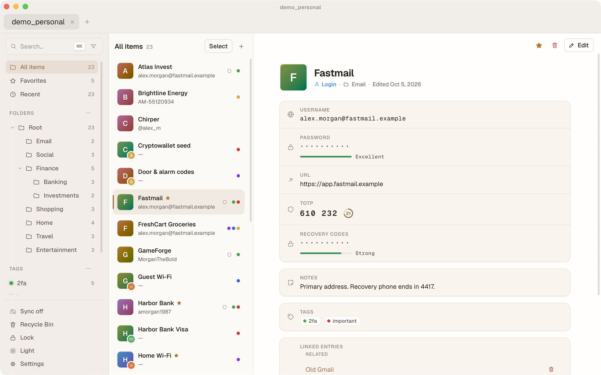
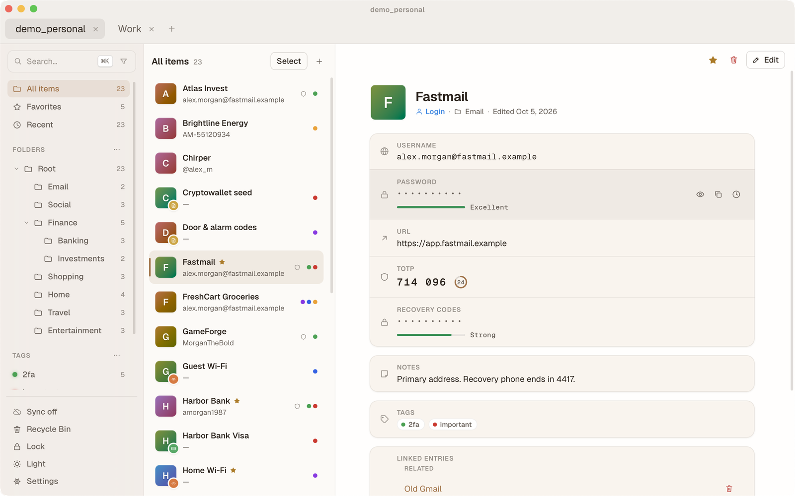
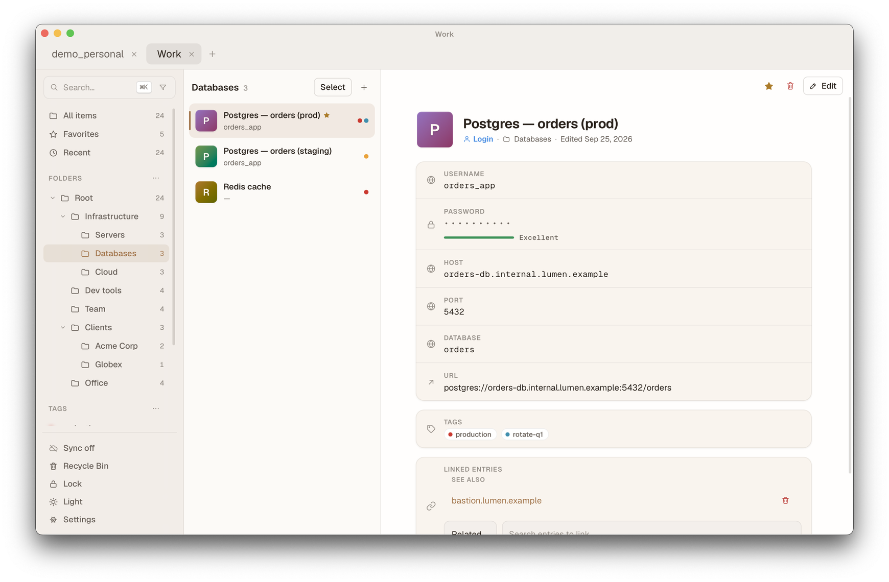
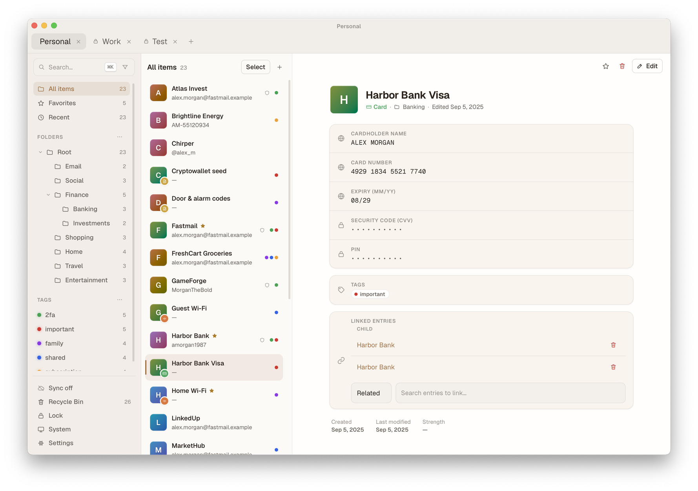
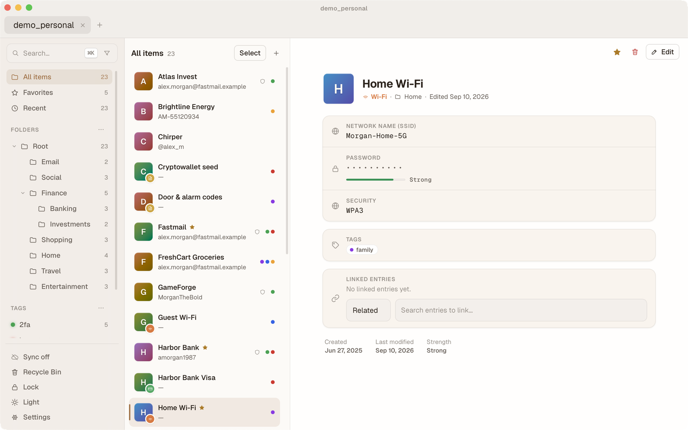
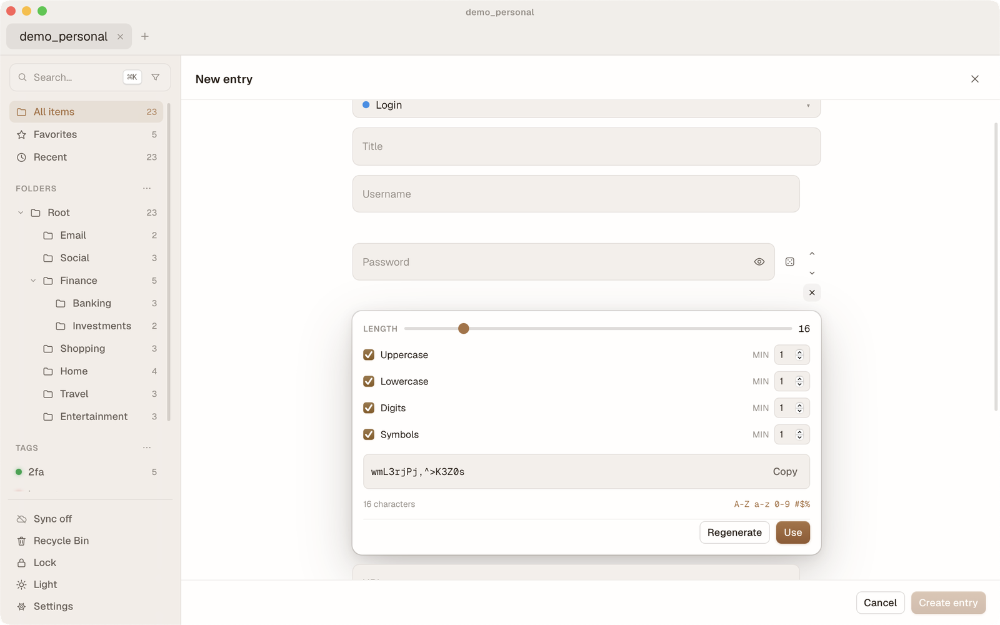
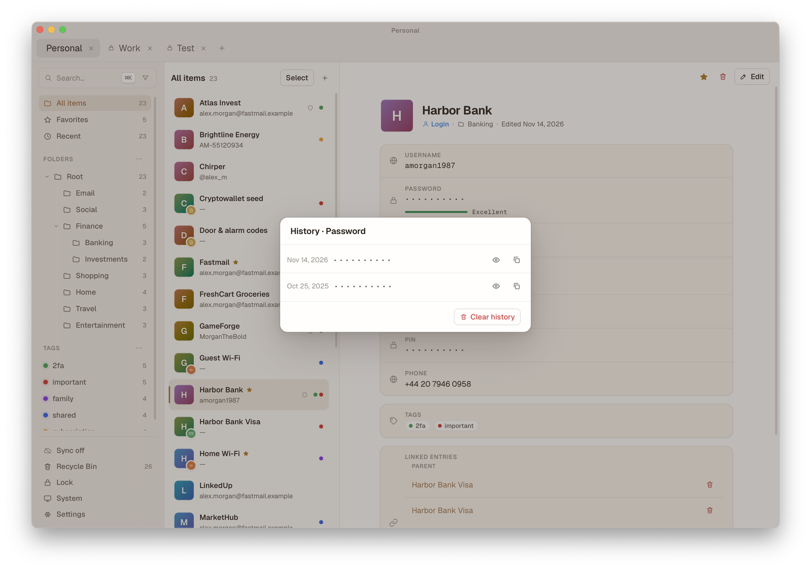
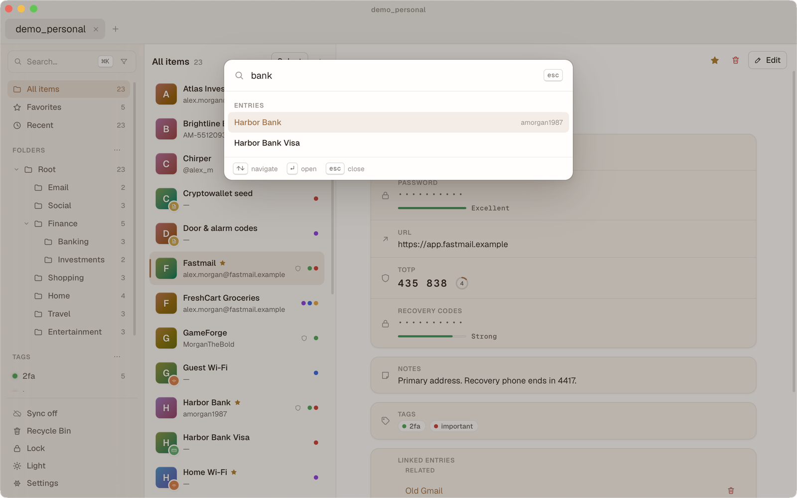
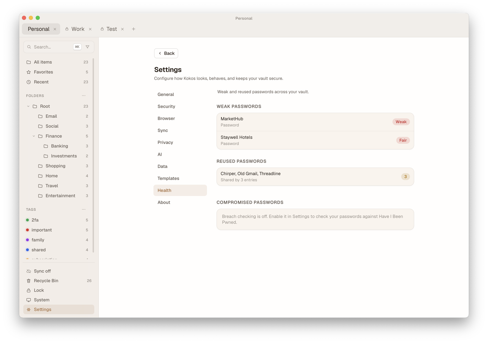

# Screenshots

Every screen follows the system light or dark appearance; GitHub shows the one that matches yours.

## Vault

<picture>
  <source media="(prefers-color-scheme: dark)" srcset="images/main-dark.png">
  
</picture>

## Several vaults in tabs

<picture>
  <source media="(prefers-color-scheme: dark)" srcset="images/vaults-dark.png">
  
</picture>

## Custom fields

<picture>
  <source media="(prefers-color-scheme: dark)" srcset="images/work-dark.png">
  
</picture>

## Card

<picture>
  <source media="(prefers-color-scheme: dark)" srcset="images/card-dark.png">
  
</picture>

## Wi-Fi entry

<picture>
  <source media="(prefers-color-scheme: dark)" srcset="images/wifi-dark.png">
  
</picture>

## Password generator

<picture>
  <source media="(prefers-color-scheme: dark)" srcset="images/generator-dark.png">
  
</picture>

## Edit history

<picture>
  <source media="(prefers-color-scheme: dark)" srcset="images/history-dark.png">
  
</picture>

## Command palette

<picture>
  <source media="(prefers-color-scheme: dark)" srcset="images/palette-dark.png">
  
</picture>

## Password health

<picture>
  <source media="(prefers-color-scheme: dark)" srcset="images/health-dark.png">
  
</picture>
